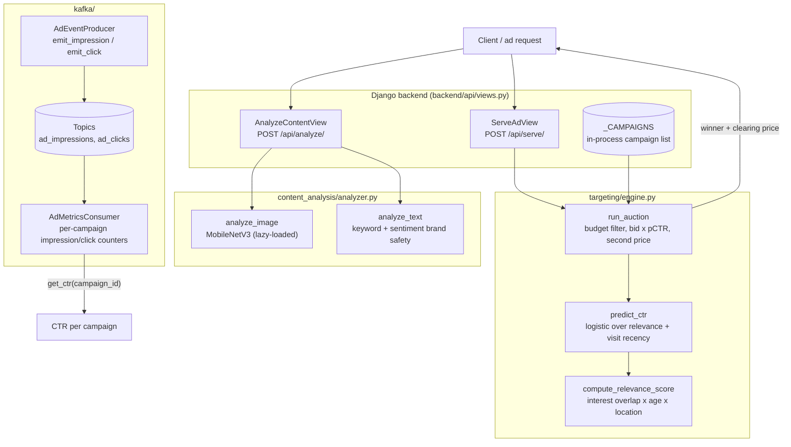
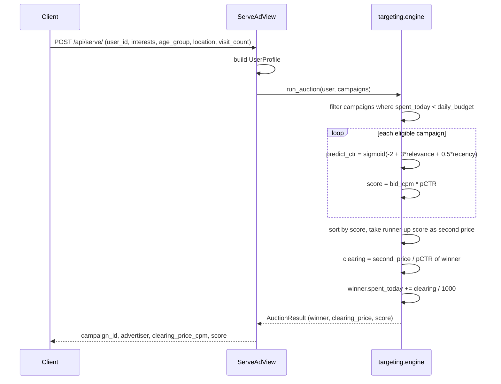

# Ad Vision

Real-time programmatic advertising platform with TensorFlow-based content analysis (brand safety + image classification), a CTR-weighted second-price auction engine, Kafka impression/click event streaming, Django REST backend, and a React dashboard.

## Overview

- **Content analysis** — MobileNetV3 image classification; keyword + sentiment brand-safety text filtering
- **Targeting engine** — interest-overlap + demographic matching → logistic CTR prediction → second-price auction
- **Kafka pipeline** — `AdEventProducer` emits to `ad_impressions` / `ad_clicks`; `AdMetricsConsumer` aggregates CTR per campaign
- **Django backend** — `/api/analyze/` (brand safety check), `/api/serve/` (auction + ad selection)
- **CloudFront CDN** — ad creative assets served from S3 via CloudFront *(planned — infra config not yet checked in)*
- **React dashboard** — campaign CTR + spend dashboard (Vite + Recharts) *(planned)*

## Tech Stack

Python 3.11 · TensorFlow · Django 5 · Kafka · React 18 · Vite · Recharts · AWS (S3 + CloudFront)

## Quickstart

```bash
pip install -r requirements.txt

# Start Kafka (Docker)
docker compose up -d kafka

# Start Django
cd backend && python manage.py runserver

# Analyze content
curl -X POST http://localhost:8000/api/analyze/ \
  -d '{"text": "Great product for fitness lovers!"}'

# Serve an ad
curl -X POST http://localhost:8000/api/serve/ \
  -d '{"user_id": "u1", "interests": ["technology"], "age_group": "25-34", "location": "US"}'

# Run tests
pytest tests/
```

## Architecture



Note on the current wiring: `/api/serve/` runs the auction directly against the
in-process `_CAMPAIGNS` list. The Kafka producer is a standalone client used to
emit impression and click events; it is not yet called from the serve path, and
the brand-safety analyzer is exposed only through `/api/analyze/`. The React
dashboard and the S3/CloudFront creative delivery are still planned.

### Auction path



## Test

```bash
pytest tests/                 # unit tests (targeting, auction)
pytest tests/test_targeting.py -k auction
```

End-to-end check: bring Kafka up via `docker compose up -d kafka`, run Django, hit `/api/serve/`, then tail `kafka/consumer.py` to confirm `ad_impressions` aggregation.

## Evaluation

Brand-safety classifier (text + image):
- **Accuracy / precision / recall / F1** on a labeled holdout — confusion matrix to inspect false-safe (most costly) vs false-block.
- Compute via `tests/` harness against a labeled CSV; planned script `ml/eval_brand_safety.py`.

CTR prediction (logistic model in `targeting/engine.py`):
- **AUC** and **logloss** on impression/click join from Kafka topics (`ad_impressions` ⨝ `ad_clicks`).
- **Calibration** (reliability diagram) — auction pricing relies on calibrated pCTR.
- **Recall@K / NDCG@K** when treating ad selection as a ranking problem over candidate ads per request.

Auction:
- **Revenue per mille (RPM)**, fill rate, average winning price vs second-bid gap, simulated with `loadtest`-style replay (planned).

## Project Structure

```
ad_vision/
├── backend/
│   ├── content_analysis/  # analyzer.py (TF MobileNetV3 + text)
│   ├── targeting/         # engine.py (CTR prediction + auction)
│   ├── api/               # Django views
│   └── ad_engine/         # Django project package
├── kafka/                 # producer.py, consumer.py
├── ml/                    # (planned) eval_brand_safety.py
├── frontend/              # (planned) React dashboard (Vite)
└── tests/                 # pytest suite
```
